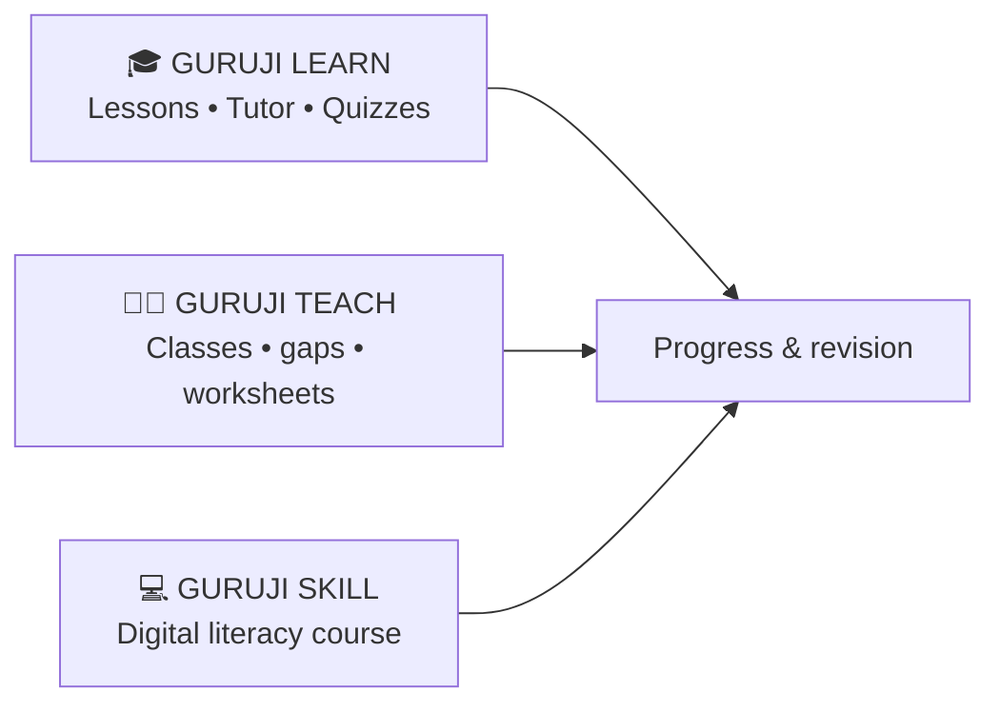
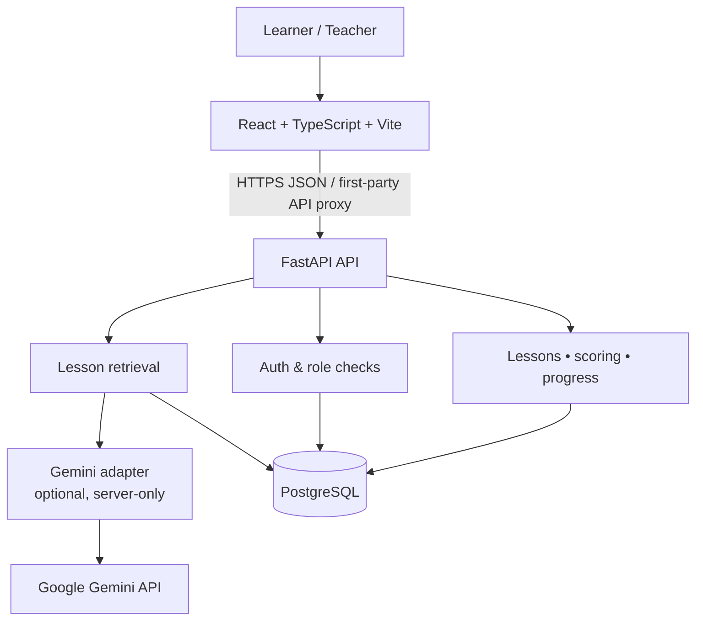
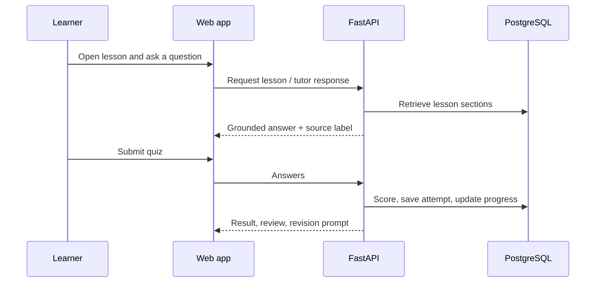

# GURUJI BOX 🎓

### One Box. Every Learner. A Smarter Village.

**GURUJI BOX** is an AI-assisted learning platform designed to make lessons, practice, teacher insight, and beginner digital skills easier to access for learners and communities in Jharkhand, India.

It treats AI as part of a learning workflow—not just a chatbot. Learners study a lesson, ask grounded questions, practise with quizzes, and see their progress. Teachers can review authorised class data and prepare editable worksheet drafts.

> **Evaluation note:** this README distinguishes the implemented MVP from planned architecture. No educational-impact, accuracy, or deployment claims are made without evidence.

## Why it matters

Learners may need another explanation, more practice, or a clearer next step. Teachers may need a quicker way to spot common misconceptions. GURUJI BOX brings those moments into one simple, mobile-first web experience.

| For learners | For teachers | For communities |
| --- | --- | --- |
| Structured lessons and quizzes | Cohort-scoped performance views | Beginner-friendly digital-skills learning |
| Source-aware tutor questions | Draft worksheets with approval status | Designed for low-complexity web access |
| Progress and revision prompts | Learning-gap signals from real attempts | Future path toward offline-first access |

## Product modules



### Implemented MVP

- Class 6 lessons for **Fractions** and **Photosynthesis**, with original seeded content.
- Session-based learner/teacher authentication and role checks.
- Server-scored quizzes, persisted attempts, mastery progress, and revision guidance.
- Lesson-grounded tutor responses with source references; an optional server-only Gemini provider adapter.
- Teacher-owned class dashboard, performance/gap endpoints, and editable worksheet drafts.
- **Digital Literacy for Beginners** course with resumable lesson completion.
- Responsive React interface for learning, quizzes, skills, teacher access, and a Hindi navigation toggle.

### Planned next

- Reviewed video-learning pipeline: script → storyboard → narration → rendered media.
- Broader curriculum, translated lesson content, and refined accessibility testing.
- Semantic retrieval only if measurement shows it improves over the deterministic retriever.
- Offline-first content and sync for unreliable-connectivity settings.

## Architecture



The MVP retrieval layer selects relevant stored lesson sections before an optional Gemini request. If evidence is weak, it returns an insufficient-evidence response rather than inventing an answer.

### Learning workflow



## Technology

| Layer | Current technology |
| --- | --- |
| Web app | React, TypeScript, Vite, React Router |
| API | Python, FastAPI, Pydantic, SQLAlchemy |
| Data | PostgreSQL for production; Docker Compose for local PostgreSQL |
| AI | `google-genai` behind a provider interface; key stays on the backend |
| Quality | Pytest, Vitest, Playwright journey scaffold, lint/typecheck/build checks |
| Deployment target | Vercel frontend + FastAPI serverless backend; Docker fallback |

## Repository map

```text
frontend/       React application
backend/        FastAPI application, data models, AI provider, tests
data/           Seeded curriculum, course, and evaluation inputs
docs/           API, database, evaluation, architecture decisions, deployment
scripts/        Deployment smoke check
```

## Run locally

**Prerequisites:** Node.js, Python, Docker Desktop, and optionally a Gemini API key for live model responses.

```bash
copy .env.example .env             # Windows; use cp on macOS/Linux
docker compose up -d
python -m pip install -r backend/requirements.txt
npm --prefix frontend install
cd backend && python -m app.seed
```

Start the API from `backend/`:

```bash
uvicorn app.main:app --reload --port 8000
```

Start the frontend from the repository root:

```bash
npm --prefix frontend run dev
```

Demo data is development-only:

| Account | Email | Password |
| --- | --- | --- |
| Demo teacher | `teacher@guruji.demo` | `DemoPass123!` |
| Demo learner | `learner@guruji.demo` | `DemoPass123!` |

## Quality and responsible AI

- Scores are calculated on the server from stored answer keys.
- Public registration cannot create an admin account.
- Teacher routes are limited to their owned classes; worksheet edits are ownership-checked.
- Provider secrets are not exposed to the frontend.
- Tutor evaluation cases live in `data/eval/questions.json`; see [evaluation documentation](docs/evaluation.md).
- Generated teacher material begins as a **Draft** and must be reviewed before approval.

Run the available checks:

```bash
cd backend && python -m pytest -q
npm --prefix frontend run lint
npm --prefix frontend run typecheck
npm --prefix frontend run test -- --run
npm --prefix frontend run build
```

## Deployment and status

Deployment is prepared but **not deployed**. Production requires a managed PostgreSQL URL, `SECRET_KEY`, `FRONTEND_ORIGIN`, and—only for live tutor generation—`GEMINI_API_KEY` and `GEMINI_MODEL`.

Follow [docs/deployment.md](docs/deployment.md) for the release checklist. The API reference, schema diagram, and project decisions are available in [docs](docs/).

## Vision

GURUJI BOX is built around a practical idea: technology should make learning easier to access, not harder to understand. The immediate goal is a reliable, secure MVP; future work should be guided by educator feedback, learner usability testing, and measured quality.

**One Box. Every Learner. A Smarter Village.**
