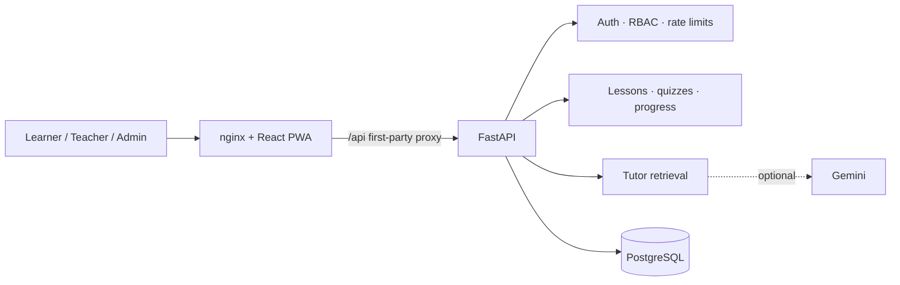

# GURUJI BOX

**One box. Every learner. A smarter village.**

GURUJI BOX is a self-hostable learning platform for learners, teachers, and community
digital-skills programmes. It combines short textbook lessons, a tutor that answers only
from lesson content, server-scored quizzes, class insight for teachers, printable
worksheets, and everyday digital-skills courses. The web app installs as a PWA on phones,
tablets, and desktops.

The project ships as a Docker Compose stack (PostgreSQL + FastAPI + nginx/React) with
migrations, curriculum seeding, an admin CLI, CI, and browser journeys. It also builds as a
self-contained Windows installer that runs the same interface, API, and SQLite database
fully offline on a classroom laptop.

---

## What you can do

| Role | Capabilities |
| --- | --- |
| **Learner** | Browse lessons by subject/class, read sections, ask Guruji grounded questions, take quizzes with explained answers, track mastery, review attempts, join classes with a code, complete digital-skills courses |
| **Teacher** | Class dashboard, create classes, share/rotate join codes, add or remove learners, inspect performance and most-missed questions, generate/edit/approve printable worksheets with an answer key |
| **Administrator** | Platform statistics, search and filter users, change roles, reset passwords, enable/disable accounts, inspect the audit trail |
| **Everyone** | English/Hindi interface, installable PWA, offline app shell, keyboard-accessible navigation, print-ready worksheets |

Everything a learner submits is scored on the server. Tutor answers are selected from the
lesson's own sections and always show their source. A Gemini key is optional; without one the
app uses the deterministic grounded answer and worksheet generator.

---

## Quick start with Docker

Requirements: Docker with Compose v2.

```bash
cp .env.example .env
# Edit .env: set SECRET_KEY and POSTGRES_PASSWORD, then PUBLIC_ORIGIN.
# For plain HTTP on localhost set SECURE_COOKIES=false.
docker compose up -d --build
```

Open <http://localhost:8080>.

Create the first administrator:

```bash
docker compose exec backend python -m app.create_admin \
  --email admin@example.org --name "School Admin" --password 'choose-a-strong-password'
```

Learners can self-register. Teacher self-registration is controlled by
`ALLOW_TEACHER_SIGNUP`; an administrator can promote any account from **Admin → Users**.

Production containers run with `APP_ENV=production`, so demo accounts and API docs are
disabled. The curriculum seed still runs on start and is idempotent.

### Put it behind HTTPS

Terminate TLS with a reverse proxy and point it at the published port:

```caddyfile
learn.example.org {
    reverse_proxy 127.0.0.1:8080
}
```

Then set `PUBLIC_ORIGIN=https://learn.example.org`, `ALLOWED_HOSTS=learn.example.org`, and
`SECURE_COOKIES=true`, and recreate the stack. Session cookies are HTTP-only and become
`Secure` automatically when `APP_ENV=production` unless overridden.

---

## Local development

Requirements: Python 3.12+ and Node.js 24+.

```bash
make setup          # Python deps + npm ci
make seed           # creates backend/guruji.db and demo accounts
make dev-backend    # http://localhost:8000 (reload)
make dev-frontend   # http://localhost:5173 (proxies /api)
```

On a fresh development database these accounts are available:

| Role | Email | Password |
| --- | --- | --- |
| Learner | `learner@guruji.demo` | `DemoPass123!` |
| Teacher | `teacher@guruji.demo` | `DemoPass123!` |
| Administrator | `admin@guruji.demo` | `DemoPass123!` |

Demo join code: `DEMO01`. Demo data is created only in development/test environments.

Useful commands:

```bash
make migrate                 # apply Alembic migrations
make migration m="add x"     # autogenerate a revision
make admin EMAIL=you@example.org PASSWORD='...' NAME="You"
make check                   # backend tests + frontend lint/typecheck/unit/build
make e2e                     # Playwright journeys on disposable ports 8010/4180
make smoke BASE_URL=http://localhost:8080
```

The backend reads configuration from environment variables first, then `backend/.env`,
then the repository root `.env`. The frontend reads `VITE_API_URL` and
`VITE_SHOW_DEMO_HINTS` at build time.

---

## Configuration

| Variable | Default | Purpose |
| --- | --- | --- |
| `APP_ENV` | `development` | `development`, `test`, or `production` |
| `DATABASE_URL` | `sqlite:///./guruji.db` | SQLAlchemy URL; Compose builds a PostgreSQL URL |
| `SECRET_KEY` | dev placeholder | JWT signing key; **required, 32+ chars in production** |
| `PUBLIC_ORIGIN` / `FRONTEND_ORIGIN` | `http://localhost:5173` | Primary browser origin allowed by CORS |
| `EXTRA_ORIGINS` | empty | Comma-separated additional origins |
| `ALLOWED_HOSTS` | `*` | Host-header allow-list; set your domain in production |
| `SECURE_COOKIES` | production: true | Override cookie `Secure` flag only for local HTTP |
| `SESSION_DAYS` | `7` | Session lifetime in days |
| `SEED_ON_START` | `true` | Run the idempotent curriculum seed at container start |
| `SEED_DEMO` | `true` in development | Create demo accounts; always refused in production |
| `ALLOW_TEACHER_SIGNUP` | `true` | Allow teacher role selection during registration |
| `CONTENT_DIR` | auto-detected | Folder containing `curriculum/` and `skill_courses/` |
| `GEMINI_API_KEY` | empty | Optional server-only AI provider |
| `GEMINI_MODEL` | `gemini-2.5-flash` | Gemini model name |
| `WEB_CONCURRENCY` | `2` | Uvicorn worker processes |
| `LOG_LEVEL` | `INFO` | Application log level |
| `RATE_LIMIT_*_PER_MINUTE` | 20/30/600 | Auth, tutor, and general request limits |
| `VITE_API_URL` | empty | API root; leave empty for the nginx same-origin proxy |
| `VITE_SHOW_DEMO_HINTS` | `false` | Show demo-account hints in production builds |

Copy [`.env.example`](.env.example) for the full annotated list. Never commit `.env`.

---

## Architecture



- **Backend:** FastAPI, SQLAlchemy 2, Alembic, PostgreSQL (SQLite for local/test), Argon2
  password hashing, JWT sessions in HTTP-only cookies, server-side scoring, audit events,
  request IDs, consistent error envelopes, rate limiting, security headers, and role/class
  scoping.
- **Frontend:** React 19, TypeScript, React Router, Vite, hand-written service worker and
  web manifest, responsive design system, full English/Hindi interface, accessible
  semantics, and print styles for worksheets.
- **Deployment:** multi-stage frontend image, non-root backend image, health checks,
  automatic migrations and content seeding on start.

API reference: [`docs/api.md`](docs/api.md). Deployment and operations:
[`docs/deployment.md`](docs/deployment.md).

---

## Install as an app (PWA)

After opening the deployed site:

- **Windows / macOS / Linux (Chrome or Edge):** use the install icon in the address bar, or
  the **Install app** card on the home page.
- **Android (Chrome):** menu → **Install app** / **Add to Home screen**.
- **iPhone / iPad (Safari):** Share → **Add to Home Screen**.

Once installed it opens full-screen. The app shell, icons, and previously loaded pages are
cached so navigation works offline; quiz submission and tutor requests still need a
connection. The service worker is registered in production builds only.

---

## Windows desktop app (fully offline)

The `desktop/` folder packages the whole product as an installable Windows application:
Electron for the window, a PyInstaller build of the FastAPI service, SQLite, and the
bundled curriculum. It needs no internet, no Docker, and no separate backend.

- **Download:** the home page has a **Download installer** card pointing at
  [GitHub releases](https://github.com/Anish17-Shanu/guruji-box/releases/latest). The
  `Desktop installer` workflow builds and attaches the installer when a `v*` tag is pushed.
- **Build locally:** `npm --prefix desktop ci && npm --prefix desktop run dist`
- **Output:** `desktop/release/Guruji-Box-Setup-<version>.exe`
- **Data:** `%APPDATA%\GURUJI BOX\guruji.db`, with **File → Open data folder** in the app.
- **Verify:** `npm --prefix desktop run smoke` launches the packaged app and checks the UI,
  local database, and absence of external requests.

The installer is currently unsigned, so SmartScreen may ask for confirmation. Full
installation, architecture, update, and signing notes are in
[`docs/desktop.md`](docs/desktop.md).

---

## Testing

```bash
make test-backend    # pytest: auth, RBAC, learning, teacher scoping, worksheets, admin
make test-frontend   # ESLint, tsc, Vitest + Testing Library
make e2e             # Playwright: public, learner, teacher, admin, PWA offline
```

The E2E suite starts its own backend with a disposable SQLite database and its own
production preview build on ports 8010/4180, so it does not touch your development data.

GitHub Actions runs all three jobs on every push and pull request.

---

## Content and AI

Seed curriculum lives in [`data/curriculum`](data/curriculum) and digital-skills courses in
[`data/skill_courses`](data/skill_courses), with original GURUJI BOX content licensed
CC BY 4.0. Attribution and license metadata are stored with each lesson and shown in the
interface.

The tutor retrieves candidate lesson sections with deterministic token-overlap ranking,
then optionally asks Gemini to answer using only those sections. Provider failures fall
back to the grounded extractive answer; a circuit breaker prevents repeated slow calls. If
the lesson does not cover a question, the tutor says so instead of inventing content.

---

## Project layout

```
backend/            FastAPI app, Alembic migrations, tests, seed and admin CLIs
frontend/           React app, unit tests, Playwright journeys, nginx config
desktop/            Electron shell, PyInstaller packaging, NSIS installer, smoke test
data/               Curriculum, skills courses, evaluation questions
docs/               API, desktop, deployment, database and design notes
scripts/            Smoke test
docker-compose.yml  PostgreSQL + backend + frontend
.env.example        Annotated configuration template
```

## Troubleshooting

- **`SECRET_KEY must be ...` on start** — set a unique 32+ character `SECRET_KEY` in `.env`.
- **Login works but the session disappears** — over HTTPS keep `SECURE_COOKIES=true`; on
  plain-HTTP localhost set it to `false`.
- **Frontend loads but API calls fail** — check `PUBLIC_ORIGIN`, `ALLOWED_HOSTS`, and that
  nginx can reach the `backend` service on port 8000.
- **Migrations keep retrying** — inspect `docker compose logs db`; the entrypoint retries
  for roughly 30 seconds while PostgreSQL starts.
- **Tutor answers are extractive** — expected without `GEMINI_API_KEY`; the grounded
  fallback is the product default.

## License

MIT for the software. Curriculum content is CC BY 4.0 unless a lesson states otherwise.
