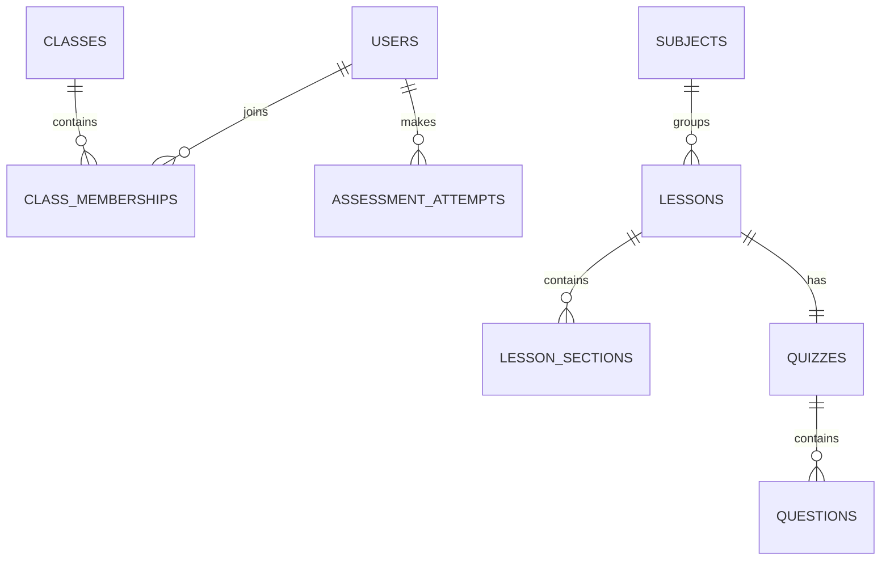

# Database

Passwords are Argon2 hashes. Tutor messages should be deleted on a configured retention schedule. Account deletion must remove or anonymise owned personal records and audit only the deletion event.
