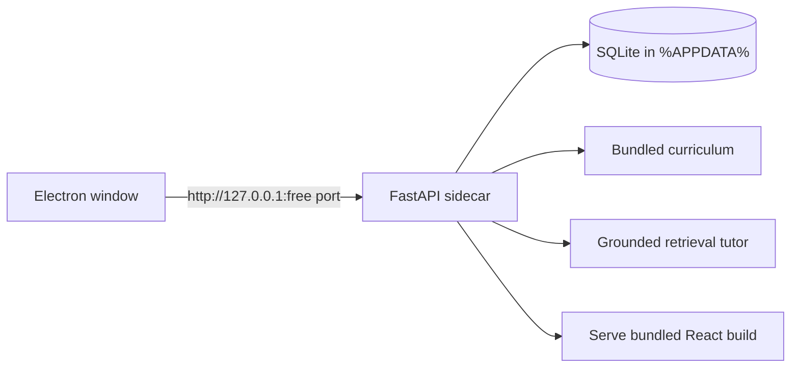

# Windows desktop app

GURUJI BOX ships as a fully offline Windows application. The installer contains the React
interface, the FastAPI service, the curriculum, and SQLite. Nothing is downloaded at runtime
and no account or internet connection is needed.

This matches the classroom architecture: one device, a projector, and no dependency on a
cloud model. The tutor uses the same grounded retrieval answer that the web app uses when
Gemini is not configured.

## Download

The website's home page has a **Download installer** card. It points at
`https://github.com/Anish17-Shanu/guruji-box/releases/latest` by default. Override the target
for a different host with the frontend build variable `VITE_DESKTOP_DOWNLOAD_URL`.

Release builds are produced by the `Desktop installer` GitHub Actions workflow when a tag
such as `v2.0.0` is pushed, and the installer is attached to that release.

## Install

1. Run `Guruji-Box-Setup-<version>.exe`.
2. Choose the install location (per-user install; administrator rights are optional).
3. Launch **GURUJI BOX** from the Start menu or desktop shortcut.

The first launch creates the local database, applies migrations, and seeds the curriculum.
Create a learner or teacher account from the sign-in screen. Demo accounts are not created
in the desktop build. Teacher self-registration is enabled so a classroom can be set up
without an administrator.

The installer is not code-signed yet. Windows SmartScreen may show an "unrecognised app"
prompt; choose **More info → Run anyway**. For distribution to schools, sign the executable
with an Authenticode certificate.

## Where data lives

| Item | Path |
| --- | --- |
| Database | `%APPDATA%\GURUJI BOX\guruji.db` |
| Session secret | `%APPDATA%\GURUJI BOX\secret.key` |
| Service log | `%APPDATA%\GURUJI BOX\backend.log` |

Use **File → Open data folder** in the app. To move a centre to another laptop, close the
app and copy this folder. The uninstaller keeps the data folder by default; delete it
manually to remove all records.

The service binds only to `127.0.0.1` on a random free port. It is not reachable from other
devices on the network.

## Build the installer

Requirements on Windows: Node.js 24+, Python 3.12+ (3.14 is also supported), and npm.

```powershell
python -m pip install -r backend/requirements.txt pyinstaller
npm --prefix frontend ci
npm --prefix desktop ci
npm --prefix desktop run dist
```

`dist` performs three steps:

1. builds the Vite frontend into `frontend/dist`;
2. packages the backend, migrations, seed data, and frontend into
   `backend/dist/GurujiBackend` with PyInstaller;
3. builds the NSIS installer into `desktop/release/Guruji-Box-Setup-<version>.exe`.

For a faster unpacked build (useful during development):

```powershell
npm --prefix desktop run build
npm --prefix desktop run dist:dir
npm --prefix desktop run smoke
```

`smoke` launches the Electron app with Playwright, checks that the interface renders, that
the database is created, and that no external network requests are made. Point it at a
packaged build with `GURUJI_DESKTOP_EXE`:

```powershell
$env:GURUJI_DESKTOP_EXE = "D:\path\to\win-unpacked\GURUJI BOX.exe"
npm --prefix desktop run smoke
```

Running `npm --prefix desktop start` uses the local Python backend directly and is the
fastest way to iterate on the shell.

## Architecture



- The Electron main process finds a free loopback port, starts
  `GurujiBackend.exe --port … --data-dir … --parent-pid …`, waits for `/ready`, then opens
  the window at that origin.
- `app.desktop` forces a production configuration with local paths, disables the Gemini
  key, applies Alembic migrations, and seeds content once. It exits if the Electron process
  disappears, so no background service is orphaned.
- Renderer isolation is on (`contextIsolation`, `sandbox`, no Node integration), popups open
  in the system browser, navigation is restricted to the local origin, and permission
  requests are denied.
- Printing worksheets uses Chromium's print pipeline, so a classroom printer works without
  extra software.

## Updating

Run the newer installer over the existing installation. The database and secret in
`%APPDATA%\GURUJI BOX` are preserved, and pending migrations run on the next launch.

## Uninstalling

Use **Settings → Apps → GURUJI BOX → Uninstall**, or the uninstaller in the install
directory. Application data remains in `%APPDATA%\GURUJI BOX` unless you delete it.

## Troubleshooting

- **The window shows a startup error** — read `%APPDATA%\GURUJI BOX\backend.log`; the most
  common causes are a blocked antivirus quarantine or a damaged installation.
- **Port or firewall prompts** — the service only listens on loopback; no firewall rule is
  required. Allow the app if a local security tool blocks loopback.
- **Antivirus flags the installer** — unsigned PyInstaller/Electron binaries are sometimes
  flagged heuristically. Build from source or sign the release.
